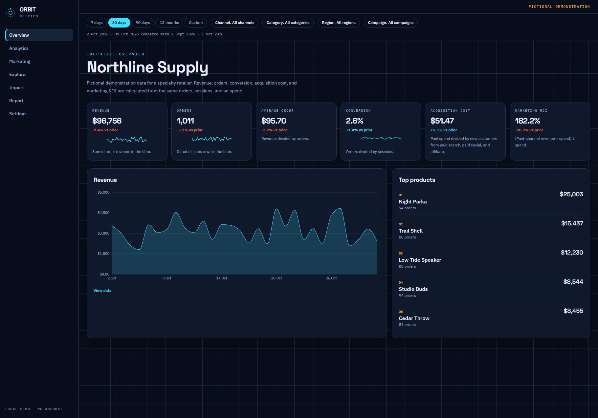

# Orbit Metrics

**See the bigger picture.**

A fictional analytics workspace for Northline Supply, a specialty retailer. Every KPI is calculated from orders, sessions, and advertising spend. Nothing on the page is a hardcoded score.

**Live site:** https://soyturkardaburak.github.io/orbit-metrics-dashboard/



The company, products, and results are demonstration data. Currency conversion uses fixed rates disclosed in Settings, not a live exchange feed.

## Features

- Executive overview with revenue, orders, average order value, conversion, acquisition cost, and marketing ROI, each compared with the previous period of the same length.
- Revenue, orders, conversion, acquisition, channel, category, and regional charts drawn from the filtered dataset.
- Campaign table with spend, impressions, clicks, CTR, CPC, CPA, revenue, and ROAS, plus ranking and export.
- Order explorer with search, sorting, pagination, and column visibility.
- CSV import that validates a documented schema, reports row errors, and either replaces or supplements the demonstration data.
- Filtered CSV export and a printable report.
- Light and dark themes, USD/EUR/GBP display, and a local reset. Preferences and imports stay in this browser.

## Stack

React 19, TypeScript, Vite, Tailwind CSS 4, Recharts, TanStack Table, Papa Parse, Zustand, Vitest, and GitHub Pages via GitHub Actions.

## Scripts

```bash
npm install
npm run dev
npm test
npm run lint
npm run build
```

Local development is served at `/`. The production build uses `/orbit-metrics-dashboard/` so GitHub Pages can host the site. Routes use a hash (`#/analytics`) so a refresh still opens the right view.

## CSV schema

The importer expects this header:

```text
record_type,date,order_id,channel,category,product,units,revenue_usd,new_customer,region,campaign,spend_usd,impressions,clicks,sessions
```

`record_type` is `order`, `campaign`, or `traffic`. The Import page lists the allowed channels, categories, and regions, and it can download a valid template. Invalid files are rejected with row numbers. They are not uploaded anywhere.

## Deployment

Pushes to `main` run `.github/workflows/deploy.yml`: install, test, lint, typecheck, build, and deploy `dist` with the official GitHub Pages actions.
